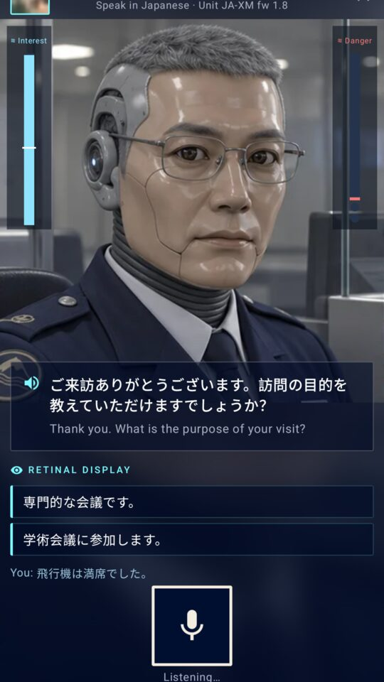
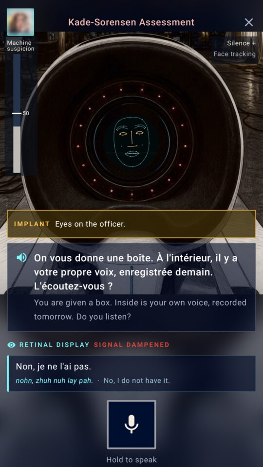

# Borderline Fluent

**A voice story game: talk your way past AI border officers in 10 languages, out loud. Every bit of AI runs on the
phone.**

[Google Play](https://play.google.com/store/apps/details?id=com.lampensoft.borderlinefluent) ·
[Trailer](https://youtu.be/kxpmA82KkWk) ·
[Press kit](https://lampensoft.com/apps/borderline-fluent/) ·
GPL-3.0 · Android 13+ with Gemini Nano · no internet permission

  
  
  
  

## The story

2035. AI companies own the only software anyone needs, and every translated word is billed. Borders went cheap:
every booth has an android officer that speaks one language, the country's own.

You needed money for your AI subscription, so you signed up for a "medical trial". Now there's a chip behind your
left eye, the Neural Retina Implant, build zero-point-nine. It listens, it translates, it whispers what to say. Most of
the time it's right. The AI companies keep their own machine at every border, and it tests travellers for exactly that.

An Android game you play by speaking:
- Your own passport: pick your nationality and roll your identity; every trip rolls a new itinerary to remember.
- Officers in 10 languages at 79 airports in 24 countries, with fixed, translated lines. They check your trip, notice
  odd answers, and react when you talk about your implant. Arabic, Turkish and Chinese are in the code but held back
  until a native speaker has checked them (`heldBackLanguages` in gradle.properties).
- Things happen in the queue before the desk, and the officer may ask what you saw. After the desk, the city: taxis,
  bars and hotels, all by voice.
- Act 2: balance facts and lies to get referred to the machine, survive its Kade-Sorensen test, and train the
  implant there. Upgrades arrive by mail.

A work of fiction.

## How it works

Everything runs on the phone: speech recognition, the answer checks and the implant's suggestions, the officers'
voices and the face reading. The app has no internet permission, no account and no ads.

The officer's mind is plain code, not the language model. Each officer has patience, suspicion and strictness, a
hidden list of what it wants to know, and fixed lines in its own language. Gemini Nano does two narrower jobs: it
checks your spoken answer against your cover story (did you answer, in the right language, and does it match?), and it
writes the implant's suggestions. The decision to stamp your passport or send you aside is always the code's.

| Part | What runs it |
| :--- | :--- |
| Officers' answer checks, the implant's suggestions | Gemini Nano through the ML Kit GenAI Prompt API |
| Speech recognition | ML Kit GenAI Speech Recognition; Whisper (sherpa-onnx) for languages the phone can't recognize |
| Hearing when you speak | Silero VAD (sherpa-onnx) |
| Officers' voices | Piper voices and eSpeak NG (sherpa-onnx), with an android ring-modulation effect |
| Answer language check | ML Kit Language ID |
| Face reading (eye contact, expressions) | ML Kit Face Detection, CameraX |
| Language packs | Play Asset Delivery, one on-demand pack per language |
| Interface | Kotlin, Jetpack Compose, Kotlin coroutines |

## How it was built

I got a Pixel 11 Pro XL and started reading about what it could do without the cloud: a language model built into the
phone, speech recognition that works offline, small voice models that fit in an app. I wanted to build something with
all of it that wasn't another chat window. A game where the AI has to listen to you, in a language that isn't yours,
and decide whether to believe you, seemed like the most interesting test.

So the officers listen, the implant whispers, and nothing you say leaves the phone. The music is by my own band.

The code was written with the help of AI coding assistants, and the story art was made with AI image tools, chosen
and checked by hand.

## Requirements

The game needs a phone with Gemini Nano (ML Kit GenAI Prompt API), 64-bit ARM and about 8 GB of RAM; it checks on first
launch and shows an "unsupported" screen elsewhere. Google keeps the list of phones with Gemini Nano in the
[ML Kit GenAI documentation](https://developers.google.com/ml-kit/genai). It has been played on a Pixel 11 Pro XL.
The Whisper speech model is downloaded only for languages the phone's own speech recognition lacks (today Ukrainian).

## Build

- Needs Java 21 and the Android SDK.
- Build and unit tests: `JAVA_HOME=/path/to/java21 ./gradlew -q testDebugUnitTest bundleDebug`
- The Whisper model is not in the repo: `scripts/fetch-models.sh` fetches it (pinned, sha256-checked).
- Install on a device with its language packs: `scripts/install.sh` (bundletool local testing; set `ANDROID_SERIAL`).
- A full release bundle: `scripts/release-local.sh X.Y.Z` (fetches the models, runs the tests, builds an unsigned AAB).

## Licenses

Copyright (C) 2026 Fluffy Pants Studio LLC. Borderline Fluent and Lampensoft are trademarks of Fluffy Pants Studio LLC.
This program is free software: you can redistribute it and/or modify it under the terms of the GNU General Public
License v3 (see `LICENSE`). It is distributed WITHOUT ANY WARRANTY.

- Code: GPL-3.0 (`LICENSE`).
- Art and audio, including the screenshots in `media/`: all rights reserved, not under the GPL (`ASSETS-LICENSE.md`).
  Forks must replace them.
- Third-party components: `NOTICE.md`.
